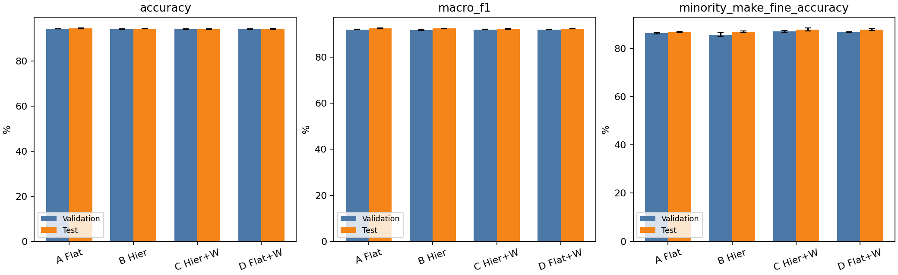
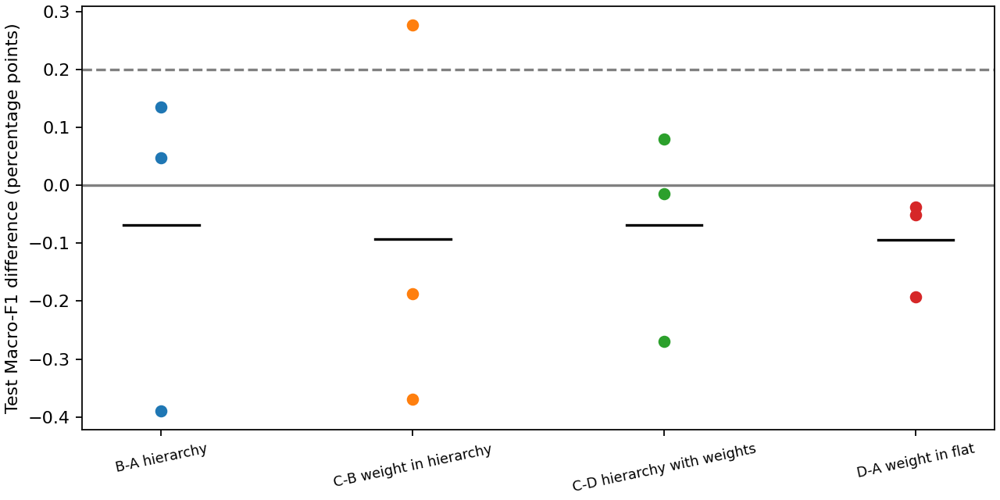

# 최종 실험 결과 및 종료 보고

고정 분할: train 82,929 / validation 17,771 / test 17,771. 4개 모델 × seed 0·1·2. 추가 학습 없이 검증 최고 체크포인트를 고정한 뒤 최종 테스트를 완료했다.

**최종 결론:** 전체 정확도와 Macro-F1은 A Flat이 가장 높았다. 제조사 계층의 주 지표 우위는 확인되지 않았다. 가중치는 테스트 소수 제조사 평균 정확도를 Flat에서 +1.068%p, 계층형에서 +0.942%p 개선했고 모두 3/3이었다. 전체 성능 이득과 집단별 이득을 구분한다. 추가 학습 없이 실험을 종료했다.

## 실험 범위와 선택 고정

A/B/C의 1차 실행 9회를 재사용하고, 2차에서 D 3회와 letterbox 선별 1회를 새로 학습했다. 최종 표의 12회는 모두 기존 중앙 크롭 조건이다. 각 실행의 체크포인트는 검증 Macro-F1로 선택했다. 최종 모델 종류는 테스트 전 A Flat으로 고정했으며, 대표 체크포인트는 A 안에서 검증 Macro-F1이 가장 높은 seed 0로 고정했다. 테스트 결과로 재선정·튜닝·추가 학습하지 않았다.

[고정 프로토콜](../result_full/make_v2/test/frozen_protocol.json)에 12개 체크포인트 SHA-256, 전처리, 분할, 코드 해시와 고정 시각을 기록했다. 각 체크포인트를 테스트에서 한 번씩 추론했고, 이후 검산과 표 생성에는 저장된 예측만 사용했다.

## 검증 성능

| 모델 | 정확도 (%) | Macro-F1 (%) | 소수 제조사 평균 정확도 (%) |
|---|---:|---:|---:|
| A Flat | 94.221 ± 0.055 | 92.017 ± 0.089 | 86.269 ± 0.287 |
| B 제조사 계층 (soft) | 94.075 ± 0.111 | 91.830 ± 0.212 | 85.664 ± 0.776 |
| C 계층+제조사 가중치 | 94.045 ± 0.140 | 91.962 ± 0.098 | 87.084 ± 0.376 |
| D Flat+제조사 가중치 | 94.129 ± 0.099 | 92.000 ± 0.036 | 86.737 ± 0.059 |

## 최종 테스트 성능

| 모델 | 정확도 (%) | Macro-F1 (%) | 소수 제조사 평균 정확도 (%) |
|---|---:|---:|---:|
| A Flat | 94.480 ± 0.170 | 92.498 ± 0.222 | 86.743 ± 0.232 |
| B 제조사 계층 (soft) | 94.279 ± 0.073 | 92.429 ± 0.130 | 86.897 ± 0.357 |
| C 계층+제조사 가중치 | 94.071 ± 0.135 | 92.336 ± 0.223 | 87.839 ± 0.659 |
| D Flat+제조사 가중치 | 94.283 ± 0.150 | 92.404 ± 0.155 | 87.811 ± 0.400 |

모든 ±는 seed 3개의 표본 표준편차다. 소수 제조사 지표는 학습 빈도가 낮은 BMW·GMC·Volkswagen 각각의 차종 정확도를 구한 뒤 세 값을 동등하게 평균한 값이다. 세 제조사 이미지를 합친 정확도가 아니다.

테스트 전에 선택한 대표 A seed 0의 정확도는 **94.288%**, Macro-F1은 **92.265%**다. 이는 단일 체크포인트 성능이며 위의 3-seed 평균과 구분한다.

## 가설·대조 비교

주 지표는 Macro-F1이다. 사전 고정한 운영상 효과 기준은 같은 seed 차이 3/3 양수와 평균 +0.2%p 초과이며 통계적 유의성 검정은 아니다. 오류율은 낮을수록 좋고, 분모는 각 평가 분할의 이미지 전체다.

| 비교 | 검증 Δ Macro-F1 (%p) | 테스트 Δ Macro-F1 (%p) | 테스트 paired SD (%p) | 테스트 개선 seed | 운영 기준 |
|---|---:|---:|---:|---:|---|
| B-A hierarchy | -0.187 | -0.069 | 0.281 | 2/3 | 미충족 |
| C-B weight in hierarchy | +0.133 | -0.093 | 0.332 | 1/3 | 미충족 |
| C-D hierarchy with weights | -0.038 | -0.068 | 0.181 | 1/3 | 미충족 |
| D-A weight in flat | -0.017 | -0.094 | 0.086 | 0/3 | 미충족 |

**H1 판정:** 검증 B−A는 −0.187%p(개선 0/3)였다. 테스트 B−A는 -0.069%p(개선 2/3), C−D는 -0.068%p(개선 1/3)다. 테스트 B−A는 운영상 효과 기준을 충족하지 못했다. 검증과 테스트의 방향·크기를 함께 보고하며, 모든 계층 구조의 우열로 일반화하지 않는다.

| 비교 | 테스트 소수 제조사 Δ (%p) | 개선 seed | 테스트 같은 제조사 오류율 Δ (%p) | 오류 감소 seed |
|---|---:|---:|---:|---:|
| D-A weight in flat | +1.068 | 3/3 | +0.006 | 1/3 |
| C-B weight in hierarchy | +0.942 | 3/3 | +0.068 | 2/3 |
| C-D hierarchy with weights | +0.028 | 1/3 | +0.248 | 0/3 |
| B-A hierarchy | +0.153 | 3/3 | +0.186 | 0/3 |

가중치의 소수 제조사 이득과 전체 Macro-F1의 변화는 별개다. 평균이 올라도 seed 방향이 일관되지 않으면 일관된 개선이라고 쓰지 않는다.

## 전처리·데이터 진단·캐시

Letterbox는 seed 0 정확도와 같은 제조사 오류율에서 일부 이득이 있었으나 Macro-F1이 92.115% → 92.015%(−0.099%p)로 낮아 미채택했다. 단일 seed 탐색 결과로 차량 단서 보존 가설 전체를 기각하지 않는다. 학습 증강과 평가 기하가 함께 바뀌어 중앙 크롭만의 인과 효과도 분리하지 못했다. 형제차 오류의 방향별 수치는 [선별 표](../result_full/make_v2/selection_pair_errors.csv)에 보관했다.

공통 오답 321장과 정답 대조군 100장을 검토했다. 라벨 의심과 구별 어려움은 단일 검토자의 잠정 분류이며 확정 원인이 아니다. 단서 잘림은 오답 246/321(76.6%), 정답 78/100(78.0%)여서 이 선택 표본에서는 오답에 더 집중되지 않았다. 학습↔검증 dHash 근접 중복 후보 670쌍(검증 548장)을 확인했으나 모두 실제 중복이라고 확정하지 않았다. 후보 제외 민감도 분석은 원 분할을 수정한 실험이 아니다. 테스트와 학습 사이 근접 중복은 추가 조사하지 않았다.

원본 uint8 캐시는 입력 동일성을 통과했지만 cache/JPEG 처리량이 0.711·0.711·0.643으로 느려 미채택했다. 이번 보존형 구현에 대한 결과이며 모든 텐서 캐시 방식에 일반화하지 않는다.

## 일반화·과적합 해석

| 모델 | 테스트−검증 정확도 (%p) | 테스트−검증 Macro-F1 (%p) |
|---|---:|---:|
| A Flat | +0.259 | +0.481 |
| B 제조사 계층 (soft) | +0.204 | +0.600 |
| C 계층+제조사 가중치 | +0.026 | +0.374 |
| D Flat+제조사 가중치 | +0.154 | +0.405 |

이 차이는 고정된 테스트 분할에서의 확인값이며 분할 간 변동이나 외부 도메인 일반화를 입증하지 않는다. 학습 중 증강 정확도와 평가 정확도는 측정 조건이 다르고, 가중 학습 손실과 검증 NLL도 직접 같게 비교할 수 없다. 과적합이 완전히 해결됐다고 단정하지 않는다. 사전학습·증강·학습 길이가 함께 달라 Task 2 대비 개선을 사전학습 하나의 효과로 설명하지 않는다.

평가 중 첫 실행 저장 후 argmax와 topk 첫 항목이 항상 같아야 한다는 검사에서 중단됐고, 동점 순위 처리에 부적합한 검사임을 확인해 제거했다. 첫 실행 예측은 해시를 보존하고 재추론하지 않았다. 모델·전처리·지표 정의는 바뀌지 않았다. 변경 이력은 evaluation_code_amendment.json과 수정 전 소스에 남겼다.

## 종료 상태

| 항목 | 상태 |
|---|---|
| 고정 분할·1차 A/B/C 3 seed·2차 D 3 seed | 완료 |
| 0단계 진단·캐시 측정·letterbox 선별 | 완료 |
| 최종 체크포인트 고정·12개 테스트 추론·저장 예측 검산 | 완료 |
| H2: 차체 유형/혼동 기반 계층 비교 | 미실행으로 종료, 지지/기각 불가 |
| 무작위 초기화 2×2 통제·고해상도·다른 손실·Grad-CAM | 미실행으로 종료 |
| 03 노트북 val 혼동 기반 그룹 생성 코드 | 이번 실행에 미사용. 향후 재사용 시 내부 검증/OOF로 수정 필요 |
| 발표 슬라이드·실시간 시연 앱 | 이번 실험 종료 작업의 산출물이 아님, 완료로 표시하지 않음 |

추가 학습·추가 전처리 탐색·테스트 재선택 없이 실험을 종료한다. 제조사 계층의 결과와 미실행 H2를 구분한다.

## 그림·근거

[테스트 결과집](../result_full/make_v2/test/README.md) · [검증 결과집](../result_full/make_v2/README.md) · [2차 검증 해설](make_v2_results.md) · [프로젝트 폴더 안내](../README.md)
