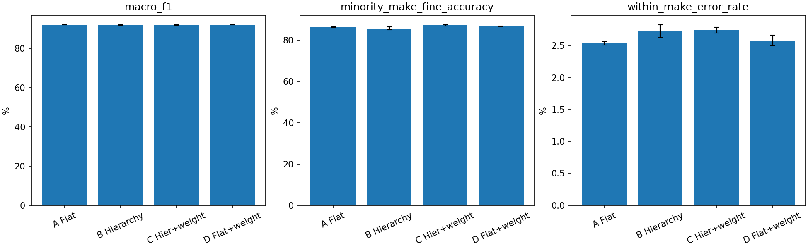
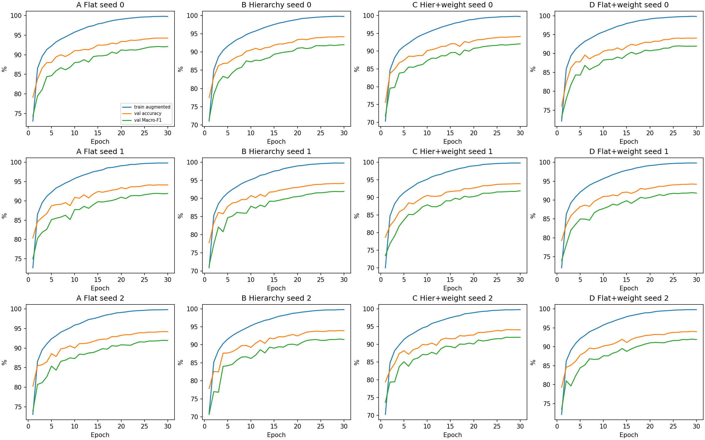

# 2차 실험 결과 정리

2026-10-23 · 검증 세트 17,771장 · seed 0·1·2. 테스트 세트는 사용하지 않았다.

전처리 선별에서는 letterbox의 Macro-F1 개선을 확인하지 못해 기존 중앙 크롭을 유지했다. 기존 A/B/C 9회 결과를 재사용하고 D(Flat+제조사 가중치)만 3회 새로 학습했다. 따라서 아래 12회 비교는 모두 기존 전처리 조건이며, 새로 학습한 것은 선별 1회와 D 3회다.

## 결론을 읽는 기준

계층 효과(B−A, C−D), 가중치 효과(D−A, C−B), 전처리 선별 효과를 따로 판정한다. 실행 전 정한 주 지표는 검증 Macro-F1이며, 같은 seed 차이가 3/3 양수이고 평균이 0.2%p보다 클 때 운영상 효과로 판정했다. 이는 통계적 유의성 검정이 아니다. 소수 제조사는 BMW·GMC·VW에 속하는 검증 이미지 전체의 차종 정확도다.

## 네 모델 결과 (3 seed 평균 ± 표본 표준편차, %)

| 모델 | 정확도 | Macro-F1 | 소수 제조사 차종 정확도 |
|---|---:|---:|---:|
| A Flat | 94.221 ± 0.055 | 92.017 ± 0.089 | 86.269 ± 0.287 |
| B 계층 | 94.075 ± 0.111 | 91.830 ± 0.212 | 85.664 ± 0.776 |
| C 계층+가중치 | 94.045 ± 0.140 | 91.962 ± 0.098 | 87.084 ± 0.376 |
| D Flat+가중치 | 94.129 ± 0.099 | 92.000 ± 0.036 | 86.737 ± 0.059 |

## 주 지표의 paired 비교

| 비교 | 평균 Macro-F1 차이 (%p) | 차이의 표준편차 (%p) | 개선 seed | 운영상 효과 |
|---|---:|---:|---:|---|
| B-A hierarchy | -0.187 | 0.199 | 0/3 | 기준 미충족 |
| C-B weight in hierarchy | +0.133 | 0.236 | 2/3 | 기준 미충족 |
| C-D hierarchy with weights | -0.038 | 0.072 | 1/3 | 기준 미충족 |
| D-A weight in flat | -0.017 | 0.076 | 2/3 | 기준 미충족 |

V2 A−V1 A의 0은 기존 A를 그대로 재사용한 값이다. 독립적인 전처리 비교가 아니다.

## 해석과 한계

**관측:** 계층형은 가중치가 없는 비교(B−A)에서 Macro-F1이 3개 seed 모두 낮았다. 같은 가중치 비교(C−D)에서도 평균은 낮고 개선은 1/3이다. 이번 조건에서 H1의 전체 Macro-F1 개선은 지지되지 않는다. 그렇다고 모든 계층 구조·학습 조건에서 효과가 없다고 일반화할 수는 없다.

가중치는 소수 제조사 차종 정확도를 D−A +0.468%p, C−B +1.420%p 개선했고 모두 3/3이다. C−D도 소수 제조사에서는 +0.346%p(3/3)다. 다만 C−D의 같은 제조사 오류율은 +0.159%p로 3/3 악화했다. 계층형의 일부 집단 이득과 전체 성능 비용을 함께 보고해야 한다. 모든 Macro-F1 비교는 사전에 정한 효과 기준을 충족하지 않았다.

**가능한 설명(검증 안 됨):** 제조사 단서의 중복, 같은 제조사 내부 구별의 어려움, 공동 학습의 영향이 계층형의 이득을 제한했을 수 있다. Task 2와 본 실험은 사전학습 외에도 증강·학습 길이 등이 함께 달라졌으므로 사전학습만의 인과 효과를 분리하지 못했다.

## 0단계 진단

- 정답 제조사를 알려주는 진단에서 A의 평균 정확도는 94.221% → 96.729%(+2.508%p), Macro-F1은 92.017% → 94.500%였다. 정답을 사용하는 진단이므로 실제 성능이 아니다. 다른 제조사 오답 전체 3.24%p가 모두 복구되는 것도 아니다.
- 9회 모두 오답인 321장과 정답 대조군 100장을 검토했다. 오답 321장의 주 분류는 라벨 의심 113, 형제차·트림 구분 어려움 119, 특이 시점 20, 저해상도 7, 가림 5, 일부 차량 4, 기타 53장이었다. 이는 단일 검토자의 잠정 판정이며 라벨 오류 확정이 아니다.
- 중앙 크롭으로 단서가 잘린 사례는 오답 246/321(76.6%), 정답 대조군 78/100(78.0%)였다. 이 표본에서는 잘림이 오답에 더 집중됐다는 증거가 없었다. 표본 선택의 한계 때문에 전체 데이터 비율로 일반화하지 않는다.
- 64-bit dHash, 해밍 거리 ≤4에서 학습↔검증 후보 670쌍, 검증 이미지 548장을 찾았다. 후보를 제외한 검증 부분집합 17,223장의 Macro-F1은 A 91.857%, B 91.658%, C 91.797%였다. 이는 후보 제외 민감도 분석이며 원 분할은 유지했다. 후보 전부를 중복으로 확정하지 않았다.

세부 근거: [0단계 결과](../result_full/make_v2/stage0/README.md).

## 전처리 선별과 텐서 캐시

Letterbox는 seed 0에서 정확도 94.266% → 94.412%, 같은 제조사 오류율 2.510% → 2.386%로 일부 개선됐지만 주 지표 Macro-F1은 92.115% → 92.015%(−0.099%p)였다. 소수 제조사 차종 정확도도 86.598% → 85.888%였다. 주 지표에 따른 선별 규칙으로 미채택했다. 단일 seed이므로 데이터 처리 가설 전체를 기각하거나 3-seed 효과로 보고하지 않는다. 학습 증강도 함께 바뀌어 중앙 크롭 하나의 효과만 분리한 실험은 아니다.

원본 RGB uint8 캐시는 픽셀·증강 입력·예측 동일성 확인을 통과했지만, 이번 보존형 구현의 속도비(cache/JPEG 처리량)는 반복 3회 0.711, 0.711, 0.643이었다. 채택하지 않았으며 전체 데이터 캐시는 만들지 않았다. PIL 변환과 복사가 남은 이번 구현의 결과이므로 모든 텐서 방식이 느리다는 뜻은 아니다. [선별 표](../result_full/make_v2/selection_comparison.csv) · [캐시 측정](../result_full/make_v2/cache_benchmark/README.md).

## 재현·검증 상태

12개 실행의 저장 예측에서 지표·혼동 행렬·최고 체크포인트 선택을 재검산했다. 고정 train/val/class_info 해시를 대조했고, D의 계층 여부와 가중치 여부를 분리했다. 같은 seed 초기 상태와 초기 증강 입력 일치도 확인했다. 검증·테스트 이미지와 라벨은 수정하지 않았다.

같은 분할에서 seed만 바꾼 3회이므로 분할 간 일반화·통계적 유의성을 입증하지 못한다. 검증 세트는 체크포인트와 전처리 선택에도 사용했으므로 최종 일반화 성능은 아직 미평가 상태다. Stage 3 무작위 초기화 대조와 최종 테스트 평가는 실행하지 않았다. 다음 단계는 설정 확정 후 별도 승인을 받아 테스트를 한 번 평가하는 것이다.

## 그림과 원자료

[실행별 지표](../result_full/make_v2/per_run.csv) · [평균·표준편차](../result_full/make_v2/mean_std.csv) · [seed별 차이](../result_full/make_v2/paired_deltas_pp.csv) · [비교 평균·편차](../result_full/make_v2/paired_mean_std_pp.csv) · [개선 seed 수](../result_full/make_v2/positive_delta_counts.csv) · [판정표](../result_full/make_v2/hypothesis_decisions.csv) · [검산 기록](../result_full/make_v2/verification.csv) · [파일 해시](../result_full/make_v2/SHA256SUMS.json)
