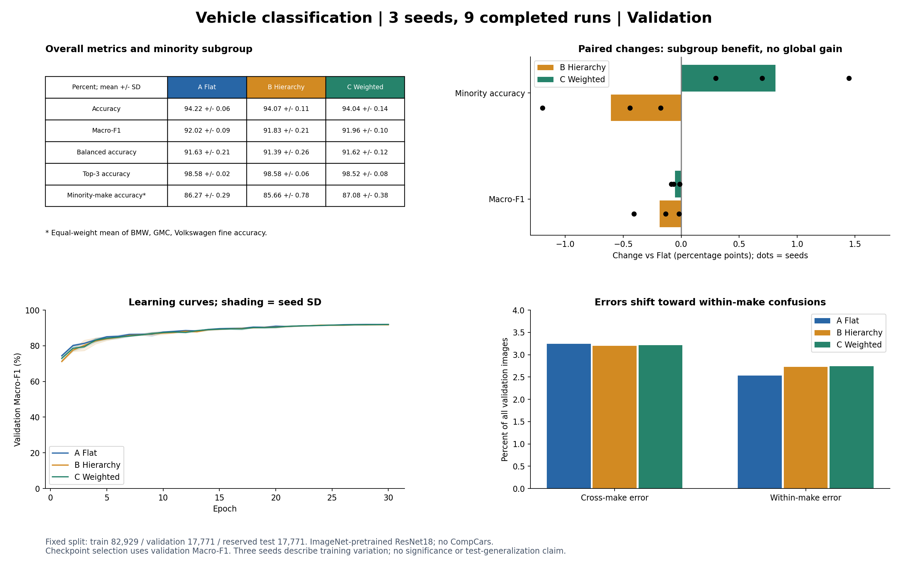
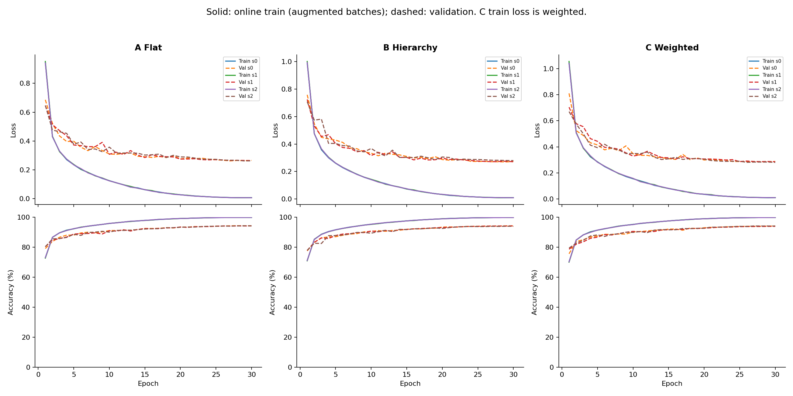

# 자동차 계층형 분류 본 실험 결과집

기본 CNN이 전체 정확도와 Macro-F1에서 가장 높았다. 제조사 가중치를 적용한 계층형은 소수 제조사 평균 차종 정확도를 높였지만, 전체 성능 향상으로 이어지지 않았다. 아래 수치는 같은 검증 세트에서 세 시드를 반복한 결과이며 최종 테스트 성능은 아니다.

## 실험 조건과 완료 확인

세 모델 × 시드 0·1·2의 9회 실행을 모두 완료했다. 최대 30 epoch, 검증 Macro-F1이 5회 연속 개선되지 않으면 종료하도록 설정했으며 실제로는 모두 30 epoch를 수행했다. 각 실행의 최고 검증 Macro-F1 체크포인트를 비교한다.

VMMRdb에서 연식을 합친 50개 제조사-모델 클래스를 사용했다. 학습 82,929장, 검증 17,771장, 테스트 17,771장으로 분할했다. 테스트 이미지는 평가하지 않았다. CompCars도 이번 비교에 사용하지 않았다.

세 모델 모두 ImageNet 사전학습 ResNet18 전체를 파인튜닝했다. 입력은 RGB 224×224, 배치 64, AdamW(초기 학습률 0.0003, weight decay 0.0001), cosine 학습률 감소를 사용했다. 학습 증강은 RandomResizedCrop, 수평 반전, ColorJitter이며 검증은 Resize와 CenterCrop이다. 같은 시드의 세 모델은 초기화·학습 순서·증강 난수를 맞췄다.

- A: 차종 50개를 직접 분류한다. 제조사 확률은 차종 확률을 제조사별로 합쳐 산출한다.
- B: 공유 특징에서 제조사 확률과 제조사 내부 차종 확률을 학습하고 두 확률을 곱한다. 모든 제조사 후보를 유지하는 soft 계층형이다. 정답 제조사는 추론에 사용하지 않는다.
- C: B와 같은 구조에 학습 제조사 빈도의 역제곱근 가중치를 적용한다. 가중치는 제조사 손실만이 아니라 최종 차종 NLL의 이미지별 가중치로 작용한다.

## 주요 결과

단위는 %이며 ±는 시드 간 표본 표준편차(ddof=1)다.

| 모델 | 정확도 | Macro-F1 | Balanced accuracy | Top-3 | 소수 제조사 차종 정확도 |
|---|---:|---:|---:|---:|---:|
| flat | 94.221 ± 0.055 | 92.017 ± 0.089 | 91.632 ± 0.210 | 98.580 ± 0.017 | 86.269 ± 0.287 |
| hierarchy | 94.075 ± 0.111 | 91.830 ± 0.212 | 91.389 ± 0.259 | 98.578 ± 0.061 | 85.664 ± 0.776 |
| hierarchy_make_weighted | 94.045 ± 0.140 | 91.962 ± 0.098 | 91.617 ± 0.122 | 98.518 ± 0.077 | 87.084 ± 0.376 |

소수 제조사는 학습 이미지 수가 가장 적은 BMW·GMC·Volkswagen으로 고정했다. 해당 지표는 제조사별 차종 정확도를 동일 비중으로 평균한다. 모든 소수 차종을 포괄하는 지표나 제조사 예측 정확도와는 다르다.

## 가설 판정

B−A의 Macro-F1 차이는 평균 −0.187%p이며 3개 시드 모두 음수였다. C−A는 평균 −0.055%p이며 역시 3개 시드 모두 음수였다. 따라서 제조사 계층과 가중치가 전체 Macro-F1을 높인다는 원래 주장은 이번 조건에서 지지되지 않았다. 당초 목표인 +2%p와 3회 중 2회 개선도 충족하지 못했다. 차이가 작다는 사실만으로 통계적 동등성이 입증된 것은 아니다.

C−B의 Macro-F1은 평균 +0.132%p로 3개 시드 중 2개에서 개선됐다. 가중치가 계층형의 전체 성능을 일부 회복했지만 A를 넘지는 못했다.

C의 소수 제조사 차종 정확도는 A보다 평균 +0.814%p, B보다 +1.420%p 높았다. A 및 B와의 비교에서 소수 제조사 성능은 세 시드 모두 개선됐다. 시드별 차이는 paired_deltas_pp.csv와 positive_delta_counts.csv에 기록했다. 이 결과는 소수 제조사에 대한 목적을 별도로 평가할 필요가 있음을 보여준다.

## 오류가 어떻게 바뀌었는가

A의 제조사 간 차종 오류율은 평균 3.243%, B는 3.198%, C는 3.213%였다. B−A의 감소 폭은 0.045%p에 그쳤고 모든 시드에서 감소한 것은 아니다. 반면 같은 제조사 안에서 틀린 비율은 A 2.536%, B 2.727%, C 2.742%로 증가했다. 오류율의 분모는 오답 수가 아니라 전체 검증 이미지 수다. 따라서 제조사 간 오류의 작은 감소를 전체 우월성으로 확대 해석할 수 없다.

confusion_pairs.csv는 실제 오분류 쌍을 기록하고, prediction_transitions.csv는 같은 이미지에서 개선 모델이 구제한 정답 수와 새로 틀리게 만든 수를 기록한다. 낮은 클래스별 F1만으로 외형 유사성이 원인이라고 단정하지 않는다. 사진 검토와 라벨 검수가 추가로 필요하다.

## 개선이 제한된 이유와 확인해야 할 것

관측된 사실은 전체 성능이 비슷하면서 소수 제조사 성능과 오류 분포가 달라졌다는 점이다. 사전학습된 특징과 차종 학습만으로 제조사 정보가 충분히 표현돼 별도 계층의 추가 정보가 작았을 가능성이 있다. 그러나 사전학습 유무를 통제한 비교를 하지 않았으므로 이 설명은 검증되지 않았다.

제조사 계층은 제조사를 맞혀도 남는 동일 제조사 내 차종 차이를 직접 해결하지 못한다. 다른 제조사의 유사 차종 역시 상위 분류가 불확실할 수 있다. 이 설명은 오류 쌍과 사례 분석으로 더 점검해야 한다. 현재 구현은 hard routing으로 후보를 제거하지 않으므로 첫 제조사 오류가 곧 정답 불가능을 뜻하지 않는다.

가중치는 손실에서 소수 제조사의 영향력을 높인다. 전체 이미지 정확도와 제조사별 균형 성능이 서로 다른 목표이므로 한쪽 개선이 다른 쪽 개선을 보장하지 않는다. 관측된 변화가 실제로 어떤 제조사 사이의 교환에서 생겼는지는 per_make.csv와 이미지별 예측으로 확인할 수 있다.

## 적용 조건과 후속 실험

상위 범주가 안정적으로 구분되고 세부 분류에 유용한 제약을 제공하는 경우 계층형이 도움이 될 가능성이 있다. 소수 제조사에 대한 오류 비용이 큰 사용 목적에서는 C의 집단 성능 개선을 별도로 평가할 수 있다. 배포 우월성을 판단하려면 해당 오류 비용을 먼저 정해야 한다.

후속 검증은 무작위 초기화/사전학습 × 직접분류/계층형을 비교해 사전학습과 계층의 상호작용을 확인하는 것부터 시작한다. 무작위 초기화에도 충분한 학습 예산을 줘야 한다. 차종 빈도 가중치, 고해상도 입력, 다른 상위 그룹은 각각 하나씩 바꿔 비교한다. 혼동 기반 그룹은 학습 내부 검증 또는 out-of-fold 예측에서 만들고 평가용 데이터를 재사용하지 않는다. 이 수정들이 성공을 보장하지는 않는다.

## 해석 범위와 검증

동일 분할의 세 시드는 학습 변동성을 보여주며 분할 변동성이나 통계적 유의성을 입증하지 않는다. 모든 체크포인트는 검증 Macro-F1으로 선택했으므로 선택에 따른 낙관성이 있을 수 있다. 최종 일반화 주장은 별도 테스트 평가 이후에 해야 한다. 예비 결과를 본 뒤 정한 하위 집단 해석은 탐색적 분석으로 구분한다. 이번 실험은 Task 2의 무작위 초기화·무증강 기준 모델과 별개다.

원본 분할 경로·MD5의 교차 중복 검사와 학습 이미지 일부의 실제 해시 확인을 수행했지만 근접 중복은 감사하지 않았다. build_result_book.py는 9회 전부에 대해 원본 예측에서 정확도·Macro-F1·Balanced accuracy·Top-3·소수 제조사 지표·오류 분해를 다시 계산하고 저장 지표와 일치함을 확인했다. 혼동 행렬, 최고 epoch, 소스 및 분할 SHA256도 점검했다. verification.csv에 실행별 통과 기록이 있다.

학습 정확도는 증강 배치에서 파라미터가 갱신되는 동안 집계한 값이다. C의 학습 손실은 제조사 가중 손실이며 검증 손실은 비가중 NLL이므로 두 손실의 절댓값을 같은 목적 함수처럼 해석하지 않는다.

## 파일과 재현

- per_run.csv, mean_std.csv: 9회 개별 결과와 평균·표준편차. CSV의 성능 값은 0~1 비율이다.
- paired_deltas_pp.csv, paired_mean_std_pp.csv: 같은 시드의 차이와 집계. 단위는 %p다.
- positive_delta_counts.csv: 양수 차이가 나온 시드 수. 오류율의 양수는 악화를 뜻한다.
- per_make.csv, per_class.csv, confusion_pairs.csv, prediction_transitions.csv: 집단·차종·오류 분석 자료.
- evidence/: 각 실행의 지표, 학습 이력, 예측, 혼동 행렬과 검증 인덱스. 이미지와 모델 가중치는 포함하지 않는다.
- sources/: 실제 실행한 학습·큐·집계 소스 스냅샷. 원본 실행에는 프로젝트 루트의 같은 이름 파일과 runs_pilot/pilot_seed0_v1/splits의 분할 스냅샷이 필요하다. 소스를 루트에 배치하고 환경·데이터를 준비한 뒤 run_full_experiments.py로 실행한다. 이 결과집만으로 원본 데이터 없이 재학습할 수 있는 것은 아니다.
- build_result_book.py: 프로젝트 루트에서 python result_full/make_v1/build_result_book.py를 실행하면 서버의 runs_full/make_v1에서 결과집을 다시 만든다. 재학습은 수행하지 않는다.

GitHub에는 본 실험 결과와 소스 증빙만 공유한다. 원본 이미지·체크포인트·smoke·맛보기 예비 결과는 포함하지 않는다.
